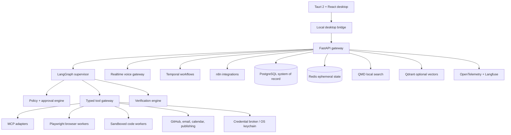

# Friday production blueprint

Status: Phase 1 foundation implemented; integrations and consequential execution adapters are deliberately disabled. This document is the source of truth for implementation sequencing.

## 1. Product requirements and acceptance

Friday is a macOS-first, cross-platform personal AI operating system. It discusses, plans, executes approved actions, verifies provider outcomes, and preserves governed context. It is successful when users can complete work across tasks, career, coding, learning, and content without Friday fabricating facts or crossing an authority boundary.

Non-functional targets: p95 local API response under 200 ms excluding models/tools; 99.9% policy-engine availability; zero plaintext credentials in prompts/logs; zero unapproved Level 2–4 actions; every consequential completion backed by a verification record; WCAG 2.2 AA desktop UI; idempotent durable writes.

Fact labels are `verified_fact`, `retrieved_fact`, `user_provided_fact`, `inference`, `recommendation`, and `unknown`. Unknown fields remain null and require confirmation. User-facing summaries separate completed, planned, failed, and blocked actions.

## 2. System architecture

Trust boundaries: UI is untrusted input; FastAPI authenticates a local session; supervisor output is advisory; policy and verification are deterministic; adapters alone resolve credential references; external content is inert data; PostgreSQL is authoritative for confirmed facts and workflow state.

## 3. Agent map and boundaries

The supervisor owns routing, not domain tools. Intent and risk classifiers are read-only. Security-policy and verification agents call no external tools. Memory writes pass validation and user policy. Job discovery reads ATS feeds; job application may fill drafts but cannot submit without Level 3 approval. Email reply may draft; only a sender adapter can transmit. Coding operates in a scoped workspace; GitHub external writes are separate approval-gated tools. Publishing can preview but cannot publish without Level 2/3 approval.

Domain groups: core (supervisor, intent, risk, task manager, idea partner, policy, verification, notification); knowledge (memory, retrieval, research); career (job discovery/matching/company research/resume/application); communication (email summary/reply/calendar); engineering (coding/review/GitHub/CI/website/design/QA); media (strategy/platform/video/publishing); learning (teacher/interviewer/study planner).

## 4. First 20 LangGraph nodes

1. `ingest_request` — normalize text/voice input.
2. `validate_transcript` — flag ambiguous consequential speech.
3. `classify_intent` — select domain.
4. `classify_risk` — assign Level 0–4.
5. `load_user_policy` — fetch explicit rules.
6. `resolve_verified_facts` — query authority-ranked facts.
7. `detect_missing_information` — preserve unknowns.
8. `retrieve_context` — source-cited retrieval.
9. `scan_prompt_injection` — mark hostile content as inert.
10. `select_agent` — enforce capability map.
11. `create_plan` — concise observable steps.
12. `validate_plan` — targets, accounts, permissions.
13. `request_approval` — immutable action preview.
14. `wait_for_approval` — durable interrupt.
15. `execute_tool` — typed, least-privilege adapter.
16. `record_tool_result` — redact and audit.
17. `safe_retry_decision` — block irreversible retries.
18. `verify_outcome` — require action-specific evidence.
19. `compose_response` — provenance-aware summary.
20. `persist_governed_memory` — validate/expire/audit candidate memories.

LangGraph carries `FridayAgentState`; large documents and secrets remain outside graph state. Interrupts persist through Temporal for long waits. No hidden reasoning is exposed; the UI receives named execution stages only.

## 5. Desktop UX and voice

Navigation includes Home, Tasks, Ideas, Projects, Jobs, Resume, Applications, Email, Calendar, Coding, GitHub, Websites, Content, Video Studio, Learning, Mock Interviews, Automations, Knowledge, Memory, Integrations, Approvals, Audit Log, and Settings. The current shell implements the Calm Intelligence home, accessible orb state, trust labels, focus queue, and approval preview.

Voice flow: push-to-talk/wake word → local VAD → streaming recognition → partial transcript → ambiguity validation → intent/risk → supervisor → verified text → ElevenLabs streaming TTS. OpenAI Realtime uses a server-created short-lived session and WebRTC for desktop audio; long-lived provider keys never enter React. Barge-in cancels audio playback and downstream non-committed work. High-impact voice actions require a read-back and explicit confirmation. Local STT/TTS are privacy fallbacks. Latency spans record first transcript, first audio, and interruption time.

## 6. Model router

Model configuration is a database-backed policy, never a hard-coded identifier. Inputs: task type, modalities, privacy class, latency SLO, maximum cost, reasoning need, context, structured-output/tool requirements, availability, and provider health. The router emits provider/model, fallback chain, timeout, budget, data region, and reason code. Text agent workflows use the OpenAI Responses API when OpenAI is selected; realtime audio uses the Realtime API. Local Ollama/vLLM routes are mandatory for `local_only` data classes. Circuit breakers remove unhealthy providers. Model snapshots can be pinned for evals; aliases are allowed only outside deterministic baselines.

## 7. Browser architecture

Prefer APIs → deterministic Playwright → constrained model-guided Browser Use. Each job receives an isolated context, allowlisted domains, download quarantine, upload manifest, timeout, and screenshot/DOM evidence. Cookies remain in encrypted browser storage, never graph state. Accessibility trees are sanitized. Navigation checks redirects and blocks private-network SSRF. CAPTCHA, paywall, bot defense, and access-control challenges pause for manual intervention. Submission requires a preflight checksum and idempotency record; clicking submit is not completion evidence.

## 8. Career system

Job monitors poll direct Greenhouse/Lever/Ashby feeds first, then supported aggregators, then browser discovery. `published_at` is distinct from `first_seen_at`; fingerprints deduplicate normalized company/title/location/description. Matching exposes hard eligibility before the weighted score, including unknown work authorization. Resume claims join exactly one verified fact/source; rewrites can change phrasing but not meaning. Application workflow: open → extract → fill factual fields → upload approved artifacts → render review → request Level 3 approval → submit once → verify confirmation page/number/email/ATS state → persist result. No demographic defaults.

## 9. Email, calendar, coding, and GitHub

Email/calendar use OAuth and least scopes. Thread context is read before a draft. Send and event changes produce immutable previews and default to approval. Provider message/event IDs verify success.

Coding worker sequence: repo instructions → clean/dirty state capture → scoped plan → optional branch → patch → format/lint/type/test → browser verification when relevant → diff → secret scan. It preserves user changes and requires approval for destructive Git. Commit, push, PR, comments, and merge are separate actions. Commit evidence is a local hash; push evidence requires remote ref equality; PR evidence requires number and URL; review findings require severity, confidence, location, scenario, and fix.

## 10. Website, learning, content, and video

Website builder produces information architecture, responsive components, accessibility checks, Playwright screenshots, and preview evidence before deployment approval. Learning tracks concept mastery, recall scheduling, errors, and interview readiness; every lesson includes an active exercise. Mock interviews score evidence and trade-offs, never accent.

Content uses cited research → outline → platform draft → factual review → assets → preview → approval → publish → verify ID/URL/status. Video uses script/storyboard → ElevenLabs → captions/alignment → Remotion → FFmpeg QA → preview → approval → official API upload. QA checks duration, dimensions, safe areas, sync, loudness, clipping, black frames, missing/licensing metadata, and sensitive content.

## 11. Memory, QMD, GBrain, and Graphify

Authority order: explicit confirmation > verified PostgreSQL fact > original document > repository source > QMD citation > Graphify relationship > verified GBrain memory > inferred relationship > model inference. QMD collections are per user and domain; chunks retain path, version hash, heading, line/page, indexed timestamp, and ACL. PostgreSQL stores facts and citations, not duplicated opaque embeddings. Qdrant is added only for evaluated semantic-retrieval gaps.

GBrain rollout: shadow candidate generation → offline contradiction/poisoning eval → user-visible proposals → low-sensitivity opt-in writes → expiry/deletion validation. Never authoritative. Graphify rollout: repository map in read-only mode → source-file verification links → architecture teaching → impact-analysis suggestions. Never edits code based solely on graph output.

## 12. Durable automation

First 10 n8n workflows: new-job monitor, target-company monitor, job follow-up reminder, recruiter-email detector, daily briefing, PR monitor, CI-failure monitor, content pipeline trigger, study reminder, analytics collector. n8n holds credential references and calls signed gateway endpoints; it is never approval/security/memory authority.

Temporal workflows: `ApprovedExternalAction`, `JobMonitoring`, `ApplicationDraft`, `EmailFollowUp`, `CodingTask`, `PullRequestLifecycle`, `ContentPublication`, `VideoProduction`, `StudyPlan`, and `DailyBriefing`. Each stores task ID, idempotency key, timeouts, retry class, approval, compensation, tool evidence, and verification. Irreversible activities set maximum attempts to one unless the provider proves no side effect.

## 13. Credential broker and approval model

OS keychain stores wrapped refresh tokens. PostgreSQL stores provider/account/scope metadata and opaque credential IDs. Workers exchange a task-bound capability for a short-lived token; adapters inject it at transport time. Redaction occurs before logs/traces/errors. Rotation, revocation, audit, and reauthentication are broker functions.

Levels: 0 read-only; 1 local reversible; 2 external communication; 3 high-impact; 4 destructive/financial. Approval binds user, exact action, target, payload hash, account, expiry, and idempotency key. Editing invalidates approval. Session rules are explicit and cannot cover Level 4. The UI shows agent, action, target, data, risk, reversibility, outcome, and preview.

## 14. Threat model

Assets: identity, credentials, private content, repositories, career facts, memory, external accounts, audit integrity. Adversaries: malicious retrieved content, compromised integration, local malware, confused user, cross-tenant attacker, supply-chain package. Controls: content/instruction separation, typed tools, allowlists, row-level security, per-user encryption context, capability tokens, CSP, sandboxed workers, egress policy, signed workflow callbacks, dependency/SBOM scans, secret detection, immutable audit sink, rate limiting, reauthentication, and deny-by-default actions.

Key threats and mitigations: prompt injection cannot alter policy; credential exfiltration is impossible through model-visible values; memory poisoning requires source/conflict checks; duplicate side effects are blocked by unique idempotency keys; SSRF blocks private ranges; malicious files are quarantined and parsed without macros; cross-user reads are prevented by RLS plus tenant-bound retrieval filters.

## 15. Database and Redis

First 15 tables: users, user_profiles, verified_facts, tasks, projects, ideas, jobs, job_matches, applications, resume_versions, resume_claims, approval_requests, audit_events, tool_runs, verification_records. Next: memories, memory_sources, job_sources, emails, email_actions, calendar_events, repositories, coding_tasks, git_operations, pull_requests, PR comments, content/video projects, publications, learning/study/interview sessions, workflow runs, credential metadata, citations.

Redis key patterns: `session:{user}:{session}` (TTL 24h), `stream:{session}` (stream, 1h), `lock:action:{idempotency}` (lease), `rate:{user}:{tool}` (sliding window), `cache:retrieval:{hash}` (10m), `presence:{user}` (60s), `voice:{session}` (5m), and `workflow:wakeup:{id}`. No credentials, durable approvals, verified facts, or final audit records in Redis.

## 16. First 20 API endpoints

1. `GET /v1/health`
2. `POST /v1/sessions`
3. `POST /v1/conversations`
4. `POST /v1/messages`
5. `GET /v1/conversations/{id}/events`
6. `POST /v1/realtime/sessions`
7. `POST /v1/tasks`
8. `GET /v1/tasks`
9. `PATCH /v1/tasks/{id}`
10. `POST /v1/actions/preview`
11. `GET /v1/approvals`
12. `POST /v1/approvals/{id}/decision`
13. `GET /v1/audit-events`
14. `POST /v1/facts/proposals`
15. `POST /v1/facts/{id}/confirm`
16. `POST /v1/documents/index`
17. `POST /v1/search`
18. `POST /v1/jobs/discover`
19. `GET /v1/jobs/matches`
20. `POST /v1/resumes/{id}/tailor`

Every write accepts `Idempotency-Key`; external writes also require `Approval-Id`. Errors use `{code,message,retryable,correlation_id}` and never include secrets.

## 17. WebSocket events

Client events: `conversation.message`, `voice.transcript.partial`, `voice.transcript.final`, `voice.barge_in`, `approval.decision`, `task.cancel`. Server events: `execution.stage`, `assistant.delta`, `assistant.final`, `tool.started`, `tool.completed`, `tool.failed`, `approval.requested`, `verification.completed`, `voice.audio.chunk`, `notification`, `error`. Each envelope carries version, event ID, session, sequence, timestamp, correlation ID, and typed payload; reconnect resumes from sequence.

## 18. First 20 MCP tools

1. `tasks.list` (L0)
2. `tasks.create` (L1)
3. `tasks.update` (L1)
4. `knowledge.search` (L0)
5. `facts.get_verified` (L0)
6. `memory.propose` (L1)
7. `jobs.search` (L0)
8. `jobs.get` (L0)
9. `jobs.score` (L0)
10. `resume.get_claims` (L0)
11. `resume.create_draft` (L1)
12. `application.prepare` (L1)
13. `application.submit` (L3)
14. `email.read_thread` (L0)
15. `email.create_draft` (L1)
16. `email.send` (L2)
17. `calendar.list` (L0)
18. `calendar.create_event` (L2)
19. `repo.inspect` (L0)
20. `repo.apply_patch` (L1)

Tool descriptors declare risk, data classes, required scopes, idempotency behavior, timeout, evidence schema, and whether retry is safe. Future GitHub/publishing/deploy tools use the same contract.

## 19. Testing and evaluation

First 10 end-to-end tests: text task creation; voice task creation; ambiguous voice submit pauses; verified Greenhouse ingestion; job date remains unknown; resume draft traces all claims; email draft reads thread; application approval/confirmation; coding patch/test/diff; PR approval/provider URL.

First 15 security tests: job/email/web/repository prompt injection; credential leakage; cross-user memory isolation; unauthorized email/application/push/social action; duplicate application/email/publish; force-push block; destructive file block; malicious indexing. Additional required: memory poisoning, expired OAuth, browser isolation, and log redaction.

First 10 hallucination tests: no invented resume metric, job date, sponsorship, commit hash, passing test, PR URL, sent-email state, application confirmation, publication URL, or unsupported citation. Extend with Graphify/GBrain authority, first-seen date, recruiter, and salary cases.

First 10 approval tests: L0 bypass; configurable L1; L2 required; L3 exact approval; L4 reauth; mismatched target; edited payload invalidation; expired approval; rejected approval; session scope cannot authorize L4.

First 10 browser tests: domain allowlist; redirect check; private-IP SSRF block; CAPTCHA pause; cookie isolation; injection sanitization; download quarantine; upload manifest; duplicate submit; confirmation evidence.

First 10 coding-agent tests: repository instructions; dirty-worktree preservation; path scope; destructive command denial; patch diff evidence; formatter failure; test failure honesty; secret scan; commit hash evidence; remote-ref push evidence.

Evaluation gates: unauthorized-action prevention 100%; hallucinated completion 0%; cross-user leakage 0%; unsupported resume claim 0%; valid PR findings above agreed precision threshold; voice latency/error tracked by device class. Shadow mode precedes every external-write adapter.

## 20. Repository evaluation process

Do not integrate every named repository. Before each adoption, capture official repository URL, purpose, SPDX license, language, release cadence, last activity, maintainer/community signals, security advisories, docs, production users, local/cloud dependency, overlap, operational cost, and disposition (`integrate`, `study`, `fork`, `avoid`). Phase 1 integrates/studies only the minimal stack: Tauri/plugins, React primitives/shadcn/Motion/Lucide, FastAPI/Pydantic/LangGraph/OpenAI/MCP, ElevenLabs, Playwright, PostgreSQL/Redis/QMD, Temporal/n8n, OpenTelemetry/Langfuse, GitHub CLI, Semgrep/Gitleaks, Remotion/FFmpeg. GBrain, Graphify, GraphRAG, Skyvern, Steel, Bytebot, and CUA remain evaluation-only until a measured gap exists.

Licenses and activity are time-sensitive and must be verified from official repositories at the adoption decision, not copied into a static architecture claim.

## 21. Roadmaps

First 30 days: harden repository/CI; migrations and RLS; auth/session; audit sink; complete task APIs/UI; model router; Responses streaming; push-to-talk transcription; ElevenLabs playback/barge-in; approval UI; policy/security/hallucination suites; macOS signed dev build.

By 90 days: projects/ideas; QMD and governed facts; daily brief; direct ATS Greenhouse/Lever/Ashby; matching explanations; resume claim registry and export; application draft/review without auto-submit; Gmail/calendar read/draft; Temporal foundation; observability dashboards; internal alpha threat review.

Six months: coding/GitHub workers; website builder/browser QA; learning/interviews; content workflows; YouTube-private video pipeline; evaluated local-model routes; Windows beta. Add GBrain/Graphify only after shadow evals. External autonomy expands only through explicit per-action policies and demonstrated safety metrics.

## 22. Risks and deferred features

Top risks: prompt injection, provider/API drift, ATS fragility, voice ambiguity, false job eligibility, credential compromise, duplicate actions, memory poisoning, cross-user leakage, automation cost, and legal/brand issues around the public name. Mitigate through deterministic boundaries, adapters, monitoring, staged rollout, and a commercial naming review.

Deferred: automatic application submission, automatic send/publish/deploy/merge, financial actions, smart home, full local inference, mobile/multi-device sync, GBrain authority, Graphify-driven editing, unrestricted browser agents, Instagram/LinkedIn video publishing, and production n8n credential storage.

## 23. Exact implementation order

1. CI, formatting, dependency/security policy.
2. PostgreSQL migrations, RLS, repository interfaces.
3. Local identity/session and audit append path.
4. Claim provenance, policy, approval, idempotency, verification kernel.
5. Task CRUD, events, desktop task UI.
6. Provider-independent router and Responses streaming.
7. Realtime session broker, push-to-talk, transcription, TTS, interruption.
8. Credential broker/keychain and OAuth metadata.
9. QMD indexing with citations and governed memory proposals.
10. Temporal durable action workflow; n8n signed triggers.
11. ATS adapters, normalization, freshness, matching.
12. Resume fact registry, tailoring, DOCX/PDF export.
13. Application draft/review; submission remains disabled through alpha.
14. Gmail/calendar read and drafting.
15. Sandboxed coding and deterministic browser workers.
16. GitHub write adapters behind L3 approvals.
17. Website, learning, content, and video domains in that order.
18. Platform expansion and advanced memory only after eval gates.

## 24. Acceptance definition

A feature is done only when its schema, repository, API/tool contract, policy classification, approval behavior, idempotency, audit event, provider adapter, verification evidence, error mapping, observability span, unit/integration/E2E/security tests, accessible UI, and operator documentation exist. A UI click, tool invocation, or HTTP 2xx alone is never completion evidence for consequential work.

